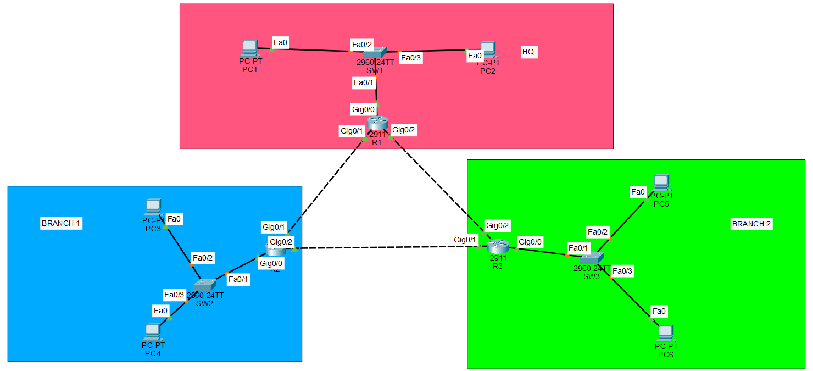

# OSPF Routing Configuration and Verification
A Cisco Packet Tracer lab demonstrating the implementation
of Open Shortest Path First (OSPF) dynamic routing across
multiple routers.

## Objectives
- Understand how OSPF (Open Shortest Path First) enables dynamic routing between multiple routers.
- Configure OSPF on multiple Cisco routers using the Cisco IOS CLI.
- Assign unique OSPF router IDs and configure the appropriate OSPF areas.
- Advertise connected networks into the OSPF routing process.
- Establish and verify OSPF neighbor adjacencies between routers.
- Examine routing tables to confirm that remote networks are learned dynamically through OSPF.
- Test end-to-end connectivity between devices on different LANs.
- Troubleshoot OSPF-related connectivity issues using Cisco IOS diagnostic commands.

## Topology


## IP Addressing

### LAN Networks

| Location | Network | Gateway |
| :--- | :--- | :--- |
| HQ | 192.168.10.0/24 | 192.168.10.1 |
| Branch 1 | 192.168.20.0/24 | 192.168.20.1 |
| Branch 2 | 192.168.30.0/24 | 192.168.30.1 |

### Router to Router networks (/30)

| Connection | Network | First router | Second router |
| :--- | :--- | :--- | :--- |
| R1 ↔ R2 | 10.0.12.0/30 | R1: 10.0.12.1 | R2: 10.0.12.2 |
| R2 ↔ R3 | 10.0.23.0/30 | R2: 10.0.23.1 | R3: 10.0.23.2 |
| R3 ↔ R1 | 10.0.31.0/30 | R3: 10.0.31.1 | R1: 10.0.31.2 |

### PC addressing

| PC | IP address | Subnet mask | Default gateway |
| :--- | :--- | :--- | :--- |
| PC-HQ1 | 192.168.10.10 | 255.255.255.0 | 192.168.10.1 |
| PC-HQ2 | 192.168.10.11 | 255.255.255.0 | 192.168.10.1 |
| PC-BR1 | 192.168.20.10 | 255.255.255.0 | 192.168.20.1 |
| PC-BR2 | 192.168.20.11 | 255.255.255.0 | 192.168.20.1 |
| PC-BR3 | 192.168.30.10 | 255.255.255.0 | 192.168.30.1 |
| PC-BR4 | 192.168.30.11 | 255.255.255.0 | 192.168.30.1 |

## OSPF Design

| Setting | Value |
| :--- | :--- |
| Routing protocol | OSPF |
| Process ID | 1 |
| OSPF area | 0 |
| R1 Router ID | 1.1.1.1 |
| R2 Router ID | 2.2.2.2 |
| R3 Router ID | 3.3.3.3 |

## OSPF Configurations

### R1-HQ
```cisco
enable
configure terminal

router ospf 1
 router-id 1.1.1.1
 network 192.168.10.0 0.0.0.255 area 0
 network 10.0.12.0 0.0.0.3 area 0
 network 10.0.31.0 0.0.0.3 area 0
 passive-interface gigabitEthernet 0/0
 exit

end
write memory
```
### R2-BRANCH1
```cisco
enable
configure terminal

router ospf 1
 router-id 2.2.2.2
 network 192.168.20.0 0.0.0.255 area 0
 network 10.0.12.0 0.0.0.3 area 0
 network 10.0.23.0 0.0.0.3 area 0
 passive-interface gigabitEthernet 0/0
 exit

end
write memory
```
### R3-BRANCH2
```cisco
enable
configure terminal

router ospf 1
 router-id 3.3.3.3
 network 192.168.30.0 0.0.0.255 area 0
 network 10.0.23.0 0.0.0.3 area 0
 network 10.0.31.0 0.0.0.3 area 0
 passive-interface gigabitEthernet 0/0
 exit

end
write memory
```

## NOTES
- router ospf 1: Starts OSPF process 1.
- router-id: Assigns a unique router identity.
- network: Identifies interfaces that should participate in OSPF and the area they belong to.
- 0.0.0.255: Wildcard mask corresponding to a /24 network.
- 0.0.0.3: Wildcard mask corresponding to a /30 network.
- passive-interface: Advertises the LAN network through OSPF but prevents OSPF neighbor discovery on that LAN interface.
