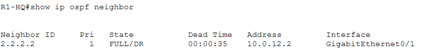
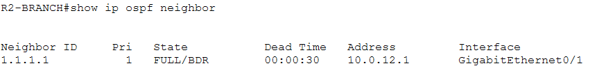
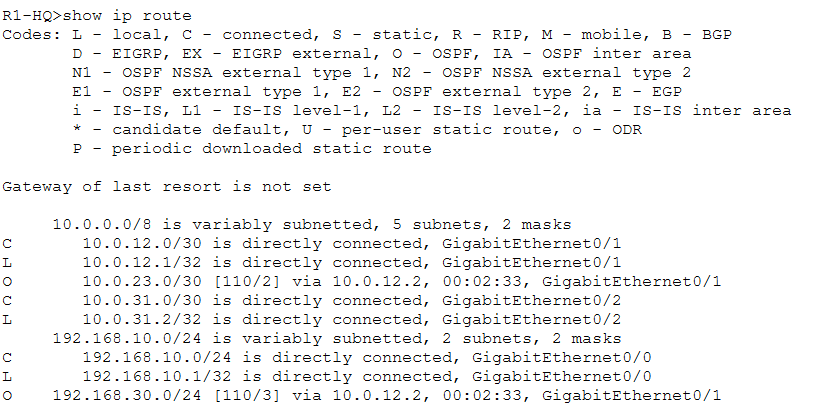
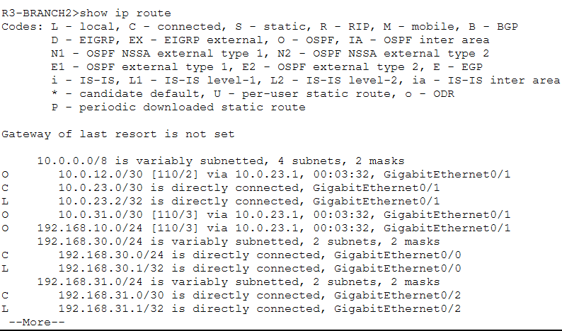
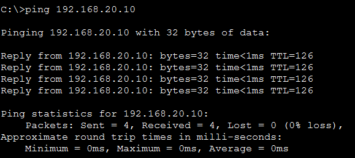
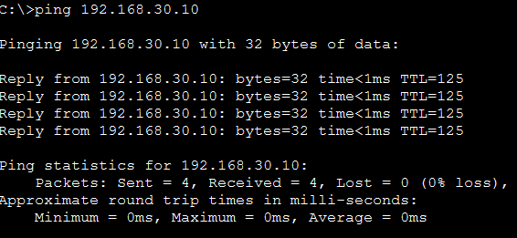
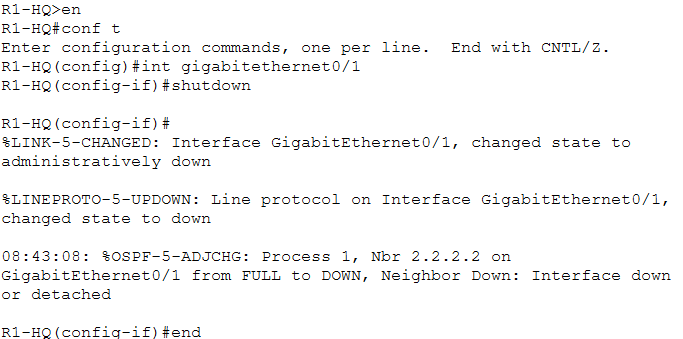
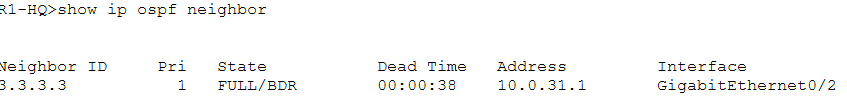
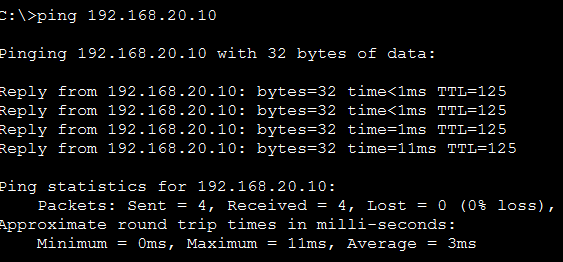

# OSPF Routing Configuration and Verification
A Cisco Packet Tracer lab demonstrating the implementation
of Open Shortest Path First (OSPF) dynamic routing across
multiple routers.

## Objectives
- Understand how OSPF (Open Shortest Path First) enables dynamic routing between multiple routers.
- Configure OSPF on multiple Cisco routers using the Cisco IOS CLI.
- Assign unique OSPF router IDs and configure the appropriate OSPF areas.
- Advertise connected networks into the OSPF routing process.
- Establish and verify OSPF neighbor adjacencies between routers.
- Examine routing tables to confirm that remote networks are learned dynamically through OSPF.
- Test end-to-end connectivity between devices on different LANs.
- Troubleshoot OSPF-related connectivity issues using Cisco IOS diagnostic commands.

## Topology


## IP Addressing

### LAN Networks

| Location | Network | Gateway |
| :--- | :--- | :--- |
| HQ | 192.168.10.0/24 | 192.168.10.1 |
| Branch 1 | 192.168.20.0/24 | 192.168.20.1 |
| Branch 2 | 192.168.30.0/24 | 192.168.30.1 |

### Router to Router networks (/30)

| Connection | Network | First router | Second router |
| :--- | :--- | :--- | :--- |
| R1 ↔ R2 | 10.0.12.0/30 | R1: 10.0.12.1 | R2: 10.0.12.2 |
| R2 ↔ R3 | 10.0.23.0/30 | R2: 10.0.23.1 | R3: 10.0.23.2 |
| R3 ↔ R1 | 10.0.31.0/30 | R3: 10.0.31.1 | R1: 10.0.31.2 |

### PC addressing

| PC | IP address | Subnet mask | Default gateway |
| :--- | :--- | :--- | :--- |
| PC-HQ1 | 192.168.10.10 | 255.255.255.0 | 192.168.10.1 |
| PC-HQ2 | 192.168.10.11 | 255.255.255.0 | 192.168.10.1 |
| PC-BR1 | 192.168.20.10 | 255.255.255.0 | 192.168.20.1 |
| PC-BR2 | 192.168.20.11 | 255.255.255.0 | 192.168.20.1 |
| PC-BR3 | 192.168.30.10 | 255.255.255.0 | 192.168.30.1 |
| PC-BR4 | 192.168.30.11 | 255.255.255.0 | 192.168.30.1 |

## OSPF Design

| Setting | Value |
| :--- | :--- |
| Routing protocol | OSPF |
| Process ID | 1 |
| OSPF area | 0 |
| R1 Router ID | 1.1.1.1 |
| R2 Router ID | 2.2.2.2 |
| R3 Router ID | 3.3.3.3 |

## OSPF Configurations

### R1-HQ
```cisco
enable
configure terminal

router ospf 1
 router-id 1.1.1.1
 network 192.168.10.0 0.0.0.255 area 0
 network 10.0.12.0 0.0.0.3 area 0
 network 10.0.31.0 0.0.0.3 area 0
 passive-interface gigabitEthernet 0/0
 exit

end
write memory
```
### R2-BRANCH1
```cisco
enable
configure terminal

router ospf 1
 router-id 2.2.2.2
 network 192.168.20.0 0.0.0.255 area 0
 network 10.0.12.0 0.0.0.3 area 0
 network 10.0.23.0 0.0.0.3 area 0
 passive-interface gigabitEthernet 0/0
 exit

end
write memory
```
### R3-BRANCH2
```cisco
enable
configure terminal

router ospf 1
 router-id 3.3.3.3
 network 192.168.30.0 0.0.0.255 area 0
 network 10.0.23.0 0.0.0.3 area 0
 network 10.0.31.0 0.0.0.3 area 0
 passive-interface gigabitEthernet 0/0
 exit

end
write memory
```

## NOTES
- router ospf 1: Starts OSPF process 1.
- router-id: Assigns a unique router identity.
- network: Identifies interfaces that should participate in OSPF and the area they belong to.
- 0.0.0.255: Wildcard mask corresponding to a /24 network.
- 0.0.0.3: Wildcard mask corresponding to a /30 network.
- passive-interface: Advertises the LAN network through OSPF but prevents OSPF neighbor discovery on that LAN interface.

## Verification and Testing

### Test1: Check OSPF Neighbors
```cisco
show ip ospf neighbor
```
Expected result:
- R1 should discover R2 and R3.
- R2 should discover R1 and R3.
- R3 should discover R1 and R2.

### R1 result


### R2 result


### R3 result


### Test2: Check Routing Tables
```cisco
show ip route
```
Look for routes marked with ``` O ``` which indicates routes learned through OSPF

### R1 result


### R2 result


### R3 result


## Test PC connectivity

### PC-HQ1 to PC3-BRANCH1 and PC5-BRANCH2
```cisco
ping 192.168.20.10
ping 192.168.30.10
```




## Testing Network Redundancy
#### Objective: 
- To demonstrate that OSPF can find an alternative path when a connection fails
#### Scenario: 
- The connection between HQ and Branch 1 goes down.

### Step 1: Establish a baseline
To confirm communication is working from PC1-HQ to PC3-BRANCH1
```cisco
ping 192.168.20.10
```


### Step 2: Simulate a link failure
Disable the direct R1–R2 connection
```cisco
enable
configure terminal

interface gigabitEthernet 0/1
 shutdown


end
```


### Step 3: Observe OSPF
```cisco
show ip ospf neighbor
show ip route ospf
```


R1 should lose its direct OSPF adjacency with R2 but not with R3

Which means OSPF be able to use R3 as an alternative path for R1 to communicate with R2

### Testing this by pinging from PC1-HQ To PC3-BRANCH1
```cisco
ping 192.168.20.10
```


### Step 3: Restore Connection
```cisco
configure terminal

interface gigabitEthernet 0/1
 no shutdown

end
```

## Troubleshooting and Fault Diagnosis

### 1. OSPF Neighbors Not Appearing

**Problem:**

After configuring OSPF on all three routers, the command:

```cisco
show ip ospf neighbor
```

returned an empty neighbor table on R1.

**Initial investigation:**

Used the following command to check OSPF-enabled interfaces:

```cisco
show ip ospf interface brief
```

The output showed:

- G0/0: OSPF enabled, Area 0.
- G0/2: OSPF enabled, Area 0.
- No OSPF neighbors detected on either interface.

**Diagnosis:**

The absence of neighbors on the router-to-router connection suggested a possible interface addressing, connectivity, or OSPF configuration issue.

---

### 2. Missing IP Address on R1's Router Interface

**Problem:**

During interface inspection, R1's G0/1 interface was found without an assigned IP address.

**Command used:**

```cisco
show ip interface brief
```

**Correction:**

Configured the missing address:

```cisco
configure terminal
interface gigabitEthernet0/1
ip address 10.0.12.1 255.255.255.252
no shutdown
end
```

**Verification:**

A ping to R2's corresponding address, `10.0.12.2`, succeeded.

This confirmed IP connectivity across the R1–R2 link.

---

### 3. Missing IP Address on R3's Router Interface

**Problem:**

R3's G0/1 interface was also found without the expected IP address during the investigation.

**Expected addressing:**

| Router | Interface | IP address |
|---|---|---|
| R2 | G0/2 | 10.0.23.1/30 |
| R3 | G0/1 | 10.0.23.2/30 |

The interface was configured with the expected address, restoring the correct addressing arrangement for the R2–R3 connection.

---

### 4. Testing Network Connectivity Between LANs

**Problem:**

A PC connected to the HQ LAN could successfully ping a PC on the Branch 2 LAN but could not reach a PC on the Branch 1 LAN.

**Tests performed:**

```text
ping 192.168.20.10
ping 192.168.30.10
```

The first ping failed, while the second succeeded.

This showed that connectivity was not working consistently across all three LANs.

Further investigation was needed to check routing tables, PC addressing, default gateways, and OSPF-learned routes.

---

### 5. Simulating an OSPF Link Failure

**Objective:**

Test OSPF's ability to maintain network connectivity when one router-to-router link fails.

**Action:**

Administratively shut down R1's G0/1 interface, which connects R1 to R2.

```cisco
configure terminal
interface gigabitEthernet0/1
shutdown
end
```

**Expected behaviour:**

- R1 should lose its OSPF adjacency with R2.
- R1 should retain its OSPF adjacency with R3 through G0/2.
- Traffic between HQ and Branch 2 should be able to use the R1–R3 connection.

**Unexpected result:**

R1's OSPF neighbor table became empty instead of retaining R3 as a neighbor.

---

### 6. Diagnosing the R1–R3 Connection

**Commands used on R1:**

```cisco
show ip interface brief
show ip ospf neighbor
show ip ospf interface brief
```

**Findings on R1:**

| Interface | IP address | Status |
|---|---|---|
| G0/0 | 192.168.10.1 | Up/Up |
| G0/1 | 10.0.12.1 | Administratively down |
| G0/2 | 10.0.31.2 | Up/Up |

R1's G0/1 was intentionally shut down for the failure simulation. G0/2 remained operational, but no OSPF neighbor was detected.

**Commands used on R3:**

```cisco
show ip interface brief
show ip ospf interface brief
show ip ospf neighbor
```

**Findings on R3:**

| Interface | IP address | Status |
|---|---|---|
| G0/0 | 192.168.30.1 | Up/Up |
| G0/1 | 10.0.23.2 | Up/Up |
| G0/2 | 192.168.31.1 | Up/Up |

R3's OSPF neighbor table showed R2 (`2.2.2.2`) in the FULL/BDR state, but R1 was missing.

**Root cause identified:**

R3's G0/2 had an incorrect IP address.

The expected address was `10.0.31.1/30`, but the interface was configured with `192.168.31.1`.

Additionally, G0/2 was not appearing in R3's OSPF interface summary.

**Proposed correction:**

```cisco
configure terminal
interface gigabitEthernet0/2
ip address 10.0.31.1 255.255.255.252
no shutdown
end
```

The interface must also be included in R3's OSPF configuration:

```cisco
router ospf 1
network 10.0.31.0 0.0.0.3 area 0
```

---

### 7. Final Verification Checklist

After correcting the R3–R1 connection, perform these tests:

**On R1:**

```cisco
show ip interface brief
show ip ospf neighbor
show ip route
ping 10.0.31.1
```

**On R3:**

```cisco
show ip interface brief
show ip ospf interface brief
show ip ospf neighbor
```

Expected results:

- R1 G0/2 and R3 G0/2 should be up/up.
- R1 should discover R3 as an OSPF neighbor.
- R3 should discover R1 as an OSPF neighbor.
- The R1–R2 adjacency should remain down while G0/1 is shut down.
- R1 should learn the Branch 2 LAN route through OSPF.

**Note:** The correction was identified during troubleshooting. The final adjacency and connectivity tests should be completed and recorded before marking the fault as resolved.

---

### Lessons Learned

1. Use `show ip interface brief` to identify missing IP addresses and interfaces that are administratively down.
2. Use `show ip ospf interface brief` to verify which interfaces participate in OSPF.
3. Use `show ip ospf neighbor` to inspect OSPF adjacency states.
4. Use `show ip route` to distinguish connected, static, and OSPF-learned routes.
5. A successful ping alone does not prove that OSPF is functioning correctly.
6. Incorrect interface addressing can prevent OSPF neighbor formation.
7. OSPF redundancy should be tested by deliberately disabling a router-to-router link and checking whether an alternative path remains available.


